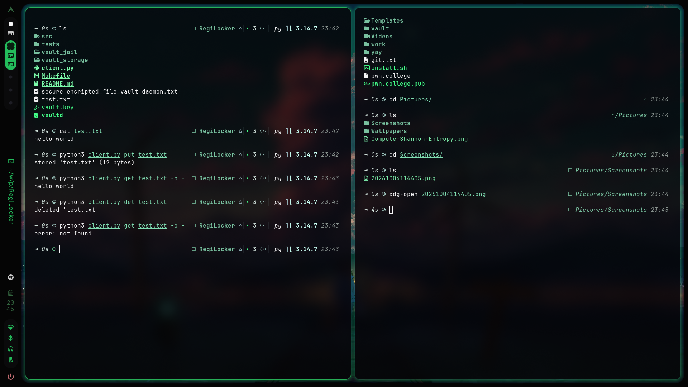

# vault_client.py

Command-line client for the encrypted file vault daemon (`vaultd`). Python 3.8+, standard library only, nothing to install.

 
 
## Usage

Start the daemon first (`./vaultd` in the vault project), then:

    # store a file (stored under its own filename)
    python3 vault_client.py put notes.txt

    # store under a different name
    python3 vault_client.py put notes.txt --name backup-2026

    # store from stdin
    echo "secret" | python3 vault_client.py put - --name secret.txt

    # retrieve: saves to ./<name> by default
    python3 vault_client.py get notes.txt
    python3 vault_client.py get notes.txt -o /tmp/copy.txt
    python3 vault_client.py get notes.txt -o -            # print to stdout
    python3 vault_client.py get notes.txt --force         # overwrite an existing local file

    # delete
    python3 vault_client.py del notes.txt

Messages go to stderr and file contents to stdout, so `get -o -` is safe to pipe.
Exit code is 0 on success and 1 on any error.

## Options

| Option | Default | Meaning |
| --- | --- | --- |
| `--host` | `127.0.0.1` (or env `VAULT_HOST`) | Server address |
| `--port` | `8080` (or env `VAULT_PORT`) | Server port |
| `--timeout` | `15` | Network timeout in seconds |

## Rules

- Vault names: 1-64 characters from `A-Z a-z 0-9 . _ -`, not starting with `.`. The client checks this before connecting.
- Maximum file size: 1 MiB.
- `put` on an existing name overwrites it. `get` refuses to overwrite a local file unless you pass `--force`.

## Common errors

| Message | Meaning |
| --- | --- |
| `cannot connect ... Is vaultd running?` | Daemon is not running, or wrong host/port |
| `not found` | No file with that name in the vault |
| `integrity check failed` | The stored file was modified, corrupted, or the daemon is using a different `vault.key` than when it was stored |
| `invalid name ...` | Name breaks the rules above |

## Use as a library

    import vault_client as vc
    vc.vault_put("127.0.0.1", 8080, 15, "hello.txt", b"hello")
    data = vc.vault_get("127.0.0.1", 8080, 15, "hello.txt")
    vc.vault_del("127.0.0.1", 8080, 15, "hello.txt")

## Security note

The connection is plain TCP and the daemon has no login. Encryption happens on the server, so the data crosses the network unencrypted. Use it on localhost or through an SSH tunnel:

    ssh -L 8080:127.0.0.1:8080 user@server
